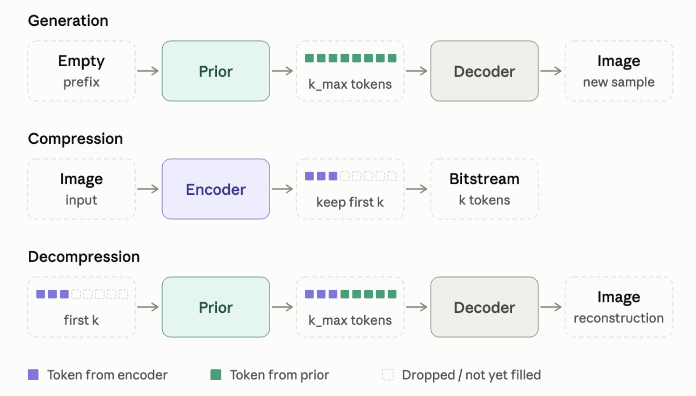

# Decoupled VAE: delta trees

A compressor and generative model for images (CIFAR-10, and MNIST) whose code is a path down a binary tree. Each
token answers one yes/no question about the image: which side of a hyperplane it lies on. Every prefix of a code is
a node, and a node decodes to a predicted mean image, so a code can be cut after any token and still decode.

The model is built in three stages, each a script that trains on the stage before's output and redraws a progress
plot as it goes:

| Stage | Script | What it learns |
|---|---|---|
| 1 | `train_encoder_components.py` (QA: `qa_components.py`) | the tree: where each node splits, and each node's mean image; it writes every image's code and the splits along it to its `tree/` folder |
| 2 | `train_prior.py --tree` | which codes are valid: p(each token's side given the ones before) |
| 3 | `train_decoder.py --tree` | p(image given its code), 256 levels per pixel value |

## Motivation

Each major choice in the design follows from the one before it.

### A learned prior, after the fact

A VAE fixes the prior, usually a standard Gaussian, and trains the encoder to fit it. VQ-VAE
([van den Oord et al., 2017](https://arxiv.org/abs/1711.00937)) dropped that constraint: the encoder and decoder
train first, the latent space takes whatever shape suits them, and a separate prior learns that shape
afterwards. This model does the same. The encoder is free to build whatever space is easiest to compress into,
and the prior is fit to its codes later.

### A one-dimensional sequence of tokens

TiTok ([Yu et al., 2024](https://arxiv.org/abs/2406.07550)) showed that an image's latent can be a short,
one-dimensional sequence of discrete tokens rather than a two-dimensional grid. Here a code is such a sequence,
of binary tokens.

### One fixed order

The encoder and the prior both decide tokens one at a time, each given the tokens before it, in the same order
every time. If tokens are decided one at a time, a fixed order is the simplest choice:

- **It costs no expressiveness.** By the chain rule, any distribution over codes factors in a fixed order.
- **It narrows what the models must learn.** They only ever see the situations that one order produces.
- **It makes every prefix of a code a code in its own right.** So the same models give a compression pipeline
  alongside the generation one.



- **Generation:** the prior samples every token, and the decoder draws an image from the code.
- **Compression:** the encoder writes the image's tokens, and the first $k$ are kept. With an entropy coder, each
  token costs about its bits under the prior.
- **Decompression:** the prior fills in the dropped tokens given the first $k$, and the decoder draws an image
  consistent with all of them. (`qa_components.py` decodes a $k$-token prefix as its node's predicted mean
  instead.)

### The encoder's objective: decompression loss

A node holds every image whose code begins with its prefix. Decompressing it means producing an image consistent
with it, and the error is set by how spread out the node's images are. So the loss of a node $\pi$ is the
expected distance between two of its images drawn independently:

```math
D(\pi) = \mathbb{E}_{x, y \sim \pi}\, d(x, y).
```

A decoder that samples from the node errs by exactly $D$ on average, and one that outputs the node's mean errs by
$D/2$. With $d$ the mean squared distance over the image's $n$ pixel values, $D$ is twice the node's total variance per pixel:

```math
D(\pi) = \frac{2}{n} \operatorname{tr} \operatorname{Cov}_\pi(x).
```

**At one node this is the k-means objective.** Splitting a node into $V$ children $v$ with shares $p_v$ and
means $\mu_v$, the loss after the token is the share-weighted sum of the children's losses:

```math
\sum_v p_v\, D(\pi_v) = \frac{2}{n}\, \mathbb{E}_{x \sim \pi} \lVert x - \mu_{v(x)} \rVert^2 ,
```

the within-cluster sum of squares. So the best split of a node is a k-means clustering of its images, with
$k = V$. Splitting greedily, one node at a time, keeps the problem tractable.

**With $V = 2$, each token is the side of a hyperplane.** Two-means assigns each point to the nearer of two
centroids. The boundary is the set of points equidistant from both, which is the hyperplane bisecting the
segment between them. So a binary token answers which side of a hyperplane the image lies on. Binary is the
simplest split, and any $V$-way decision can be built from binary ones.

### Predict means, not hyperplanes

The ideal encoder would output the best hyperplane for any node. But the two-means objective is not convex in
the hyperplane. It has many separate good optima, and swapping the two sides gives the same split. A network
trained to regress the best hyperplane would average between optima and land on a split that is good for none of
them.

What is well defined for any hyperplane is the mean of the images on each side. That is a conditional
expectation, smooth in the hyperplane, and regression learns it well. So the encoder predicts the two side means
for a given node and hyperplane, and Lloyd's algorithm does the search: move the hyperplane to the bisector of the
predicted means, and repeat. That is k-means' own algorithm, with the network standing in for the node's images.
So it also works at deep nodes, which hold one training image or none.

### Why a separate prior

The encoder already implies a share for every split: its $m$, with $p = m / (1 + m)$. With unlimited data and
capacity, that share and a separately trained prior would converge to the same answer. In practice both must
compromise, and they compromise differently.

**The encoder's $m$ is trained to place a mean, not to predict a share.** Its loss only asks that the common
side's predicted mean, $-m\,r$, land on the actual common-side mean $\bar c$. The best $m$ is then the projection

```math
m = -\frac{\langle \bar c, r \rangle}{\lVert r \rVert^2},
```

which equals the share ratio $p / (1 - p)$ only when $p\,r + (1 - p)\,\bar c = 0$. That holds when the node's
images really are centred on its predicted mean. Any error left by earlier tokens breaks it. For example, along
$r$'s direction, with the node's predicted mean at 0:

| side | actual share | actual mean |
|---|---|---|
| rare | 0.25 | +2.0 |
| common | 0.75 | -0.2 |

The node's images are centred at $0.25 \cdot 2 - 0.75 \cdot 0.2 = 0.35$, not 0.
- **The encoder's fit:** $r = 2$ and $m = 0.1$, which put both side means exactly right. That implies a share of
  $0.1 / 1.1 \approx 0.09$.
- **The cost to compression:** pricing the token at 0.09 costs 0.968 bits on average. The true share of 0.25,
  which a prior trained on cross-entropy learns, costs 0.811. That wastes 0.16 bits on this token.
- **The cost to sampling:** a sampler using the encoder's share picks the rare side about a third as often as
  real images go there.

Errors build up with depth, so this gap should grow with depth, and it does. On MNIST, with an earlier encoder,
at 119 tokens, the encoder's own shares cost about 1.00 bit per token at depths 65-119, while the prior's cost
0.90.

Two more differences:
- **A cap:** $m \le 1$ caps the encoder's share at one half. It can never say that the rare side holds most of a
  node's images, and the prior can.
- **The right loss:** cross-entropy is the loss whose compromise compression and sampling actually pay for.

(When the encoder merely cannot tell two situations apart, but each has its images centred on its predicted mean,
both models settle on the same pooled share. It takes error in the means to pull them apart.)

So the two predictions serve different purposes:
- **The encoder's is to produce a space with an easy-to-learn prior.**
- **The prior's is to learn which codes in that space are valid,** correcting the encoder's shares where they
  are wrong.

### Why a separate decoder

For a code, the encoder outputs a single image: its node's predicted mean. That is the best single guess under
squared error. But a node still holds many images, so the mean is a blur of them, and a point estimate gives no
likelihood to score.

The decoder models $p(x \mid \text{code})$: a distribution over each pixel's 256 grey levels, given the code and
its mean image.
- **Likelihoods:** the whole model can then report bits per dimension.
- **Sharp samples:** samples, or each pixel's most likely level, have sharp strokes where the mean is blurry.

Keeping it separate leaves the codes alone. The encoder chooses its splits for the decompression loss, and the
decoder is fit afterwards to the frozen codes, without pulling them toward whatever is easiest to model one pixel
at a time. It does treat pixels as independent given the code, which is why its single draws look speckled.

## How it works

### Stage 1: the encoder, as frozen components

**Nodes and remainders.** Pixel values are their levels' bin centres, (level + 0.5) / 256. The root's predicted
mean is the training mean; each token adds a delta, so a node's predicted mean is the training mean plus its
deltas so far. An image's remainder at a node is the image minus that predicted mean.

**One small network per (depth, Lloyd step), frozen once trained.** Given a node's history and a hyperplane
$(n, b)$, a network predicts the mean delta $r$ of the hyperplane's rare side and the ratio $m \in [0, 1]$ of the
rare side's share to the common side's. The common side's mean delta is then $-m\,r$, so the two predicted side
means always average back to the node's own (the tower property):

```math
p\,r + (1 - p)(-m\,r) = 0 \quad\text{when}\quad m = \frac{p}{1 - p}.
```

**Lloyd's algorithm through the networks.** At each depth, step 0 asks every node about the depth's start: the
top principal direction of the training remainders there, through the node's predicted mean ($b = 0$). Step $t$
asks about the bisector of step $t - 1$'s predicted side means: normal $r / \lvert r\rvert$, bias
$\lvert r\rvert (1 - m) / 2$. After the depth's chosen number of steps each image goes to the side it lies on,
and that side's predicted delta extends its node's history. Every query depends only on the code, never on the
image, so a code alone replays the encoder's choices and maps back to its node's predicted mean image.

**Training.** The tree grows one depth at a time and each depth one Lloyd step at a time. Each step's network
trains on that step's fixed nodes (every network above it frozen), to predict the actual side means of the
training images there, and is then frozen itself. It starts from whichever of these has the lowest val mse at
its step: the most recently trained network, the previous depth's network at the same step, and with `--init`
an earlier run's network at the same (depth, step).

**Three counts, one rule.** Epochs per network, Lloyd steps per depth and depths are each chosen as the $n$
maximizing (val mse gain after $n$) $-$ threshold $\cdot n$, giving up once $n$ passes the best by a patience
(`--epoch-*`, `--lloyd-*`, `--depth-*`). A depth costs a token while steps and epochs cost only time, so the
thresholds are ordered: unless given, the step threshold is the depth threshold / 25 and the epoch threshold the
step threshold / 40. An epoch is `--images-per-epoch` training images (22,528 by default, with a val measurement
after each), taken from one endless stream of shuffles of the training set that every network reads in turn, so
an epoch means the same however big the dataset is (`--flip` doubles it with mirror images).

**Speed.** A node's history is its last `--history-window` deltas plus one token for the sum of those before, so
a network's cost and the history tables stop growing with depth; the tables are 8-bit and stay on the GPU. An
L40S in bfloat16 runs a depth in about 7 s on CIFAR-10. V100s have no bfloat16: use `--fp16` there (about 1.3x
faster than float32, which is about 4x slower than the L40S).

**Reruns.** `--init RUN` reuses another run's networks as they are while every choice so far is that run's, and
trains from the first difference on. A run saves `state.pt` (every split's remainders, nodes and history tables)
every `--snapshot-every` depths and at the end, so a rerun that only lowers `--depth-threshold`, or `--resume`
after an interruption, starts from there at once instead of replaying. Reused networks and tree files are hard
links, not copies. An exact replay needs the same GPU type and precision: bfloat16 networks replayed on a V100
drift.

**What a run keeps** (in `artifacts/<job>/`): `models/dDDD_sSS.pt` (every network trained; step 0's
also holds the depth's start), `tree/<split>/dDDD.pt`
(for train, val and test, each depth's chosen split: every node's $r$, $m$ and $b$, each image's side and next
node, each next node's parent, side and key: what the prior and decoder read), `records.json` (every network's
and depth's numbers; `kept` is the depths in the tree), `run.log` and the plot `run.png`.

`qa_components.py --run artifacts/<job>` replays the kept tree from the models alone (step 0's checkpoint holds
its depth's start) on every val image and some train and test images, and writes `compress_{train,val,test}.png`
(images, then their reconstructions after a spread of code lengths), `samples.png` and `samples_by_depth.png`
(codes sampled with the encoder's own shares), `real.png`, and `mse.png` (the replay's mse by depth beside the
run's records, which the val replay matches exactly on the same GPU type). For a run from before starts were
saved, it recomputes the missing ones from every training image once and writes them into the checkpoints.

### Stage 2: the prior

`train_prior.py --tree` trains a causal transformer that reads a code's splits in order, one token per depth,
and predicts each token's side. Token $k$ sees its own split ($r$'s direction and length, and $m$), the side
taken before it and, with `--images`, the two mean images it chooses between (the node's mean plus $r$ and minus
$m\,r$), read by a small convolutional net.

Causal attention lets token $k$ see everything before it but not its own side, so one pass over a code trains
every depth. Depths need different amounts of training, so early stopping runs separately in `--bands` bands of
depths: each band keeps the weights of its own best val epoch, and the kept prior answers each depth with its
band's weights.

### Stage 3: the decoder

`train_decoder.py --tree` trains $p(x \mid \text{code})$: 256 logits per pixel value from the code's history and
its node's predicted mean image. It adds what the encoder's mean leaves out, each value's spread around it. Test
images are then scored as $-\log_2 p(\text{code}) - \log_2 p(x \mid \text{code})$, the one-code upper bound on
$-\log_2 p(x)$, with the code priced by the prior (`--prior`) or else by the encoder's own shares.

## Results so far (CIFAR-10)

The encoder, by the val mse of a code cut after its last kept token (test is within 1% of val throughout):

| run | what | tokens | val mse | GPU hours |
|---|---|---|---|---|
| 510 | one shared network for every node (the earlier design) | 120 | 0.0146 | 11 (V100/L40S) |
| 520 | frozen components, full history | 120 | 0.0116 | 1.36 |
| 535 | + history window 16, 8-bit tables, epoch patience 1 | 120 | 0.0116 | 0.36 |
| 543b | 535 rerun with the depth threshold / 4 | 256 | 0.0076 | 0.23 |
| 569 | 543b rerun with depth threshold 1e-6 | 1162+ (running) | 0.0023 | 3.2 |

- **Depth is what buys mse.** Lower step and epoch thresholds buy only about 0.25% at equal depth, and width,
  learning rate, dropout and an L2 anchor to the warm start change less than 0.4% (the anchor hurt).
- **Mirror images (`--flip`)** lower val mse by about 2% at 60 tokens and 3.6% at 409, but cost 1.4x the time per
  depth: worth it per token, not per GPU hour.
- **The prior** cannot yet beat the best constant share per depth on these codes (119.971 bits against 119.966 for
  120 tokens), so the codes look close to incompressible as they are.
- **The decoder** on 520's 120-token codes scores 6.60 bits per dimension on the test set.

Earlier results on MNIST, with the shared-network encoder, are in `git show 7de2210:README.md`.

## Running it

```bash
source .venv/bin/activate   # torch, torchvision, matplotlib; the datasets download to data/ on first run
```

The device is picked automatically (CUDA, then Apple's MPS, then the CPU); `--device` overrides it. Each run's
files go to `artifacts/<job>/`, named by `$DVAE_JOB` or else by the script and the time.

```bash
python train_encoder_components.py --dataset cifar10 --tf32 --bf16 --depth-threshold 1e-6
python qa_components.py --run artifacts/<encoder job>
python train_prior.py --tree artifacts/<encoder job> --images --tf32
python train_decoder.py --tree artifacts/<encoder job> --prior artifacts/<prior job>/prior.pt --tf32
```

Type checking (pyright's basic mode) must end with 0 errors and 0 warnings:

```bash
npx --yes pyright
```

## On BU's SCC

The repo lives at `/projectnb/cs599bg/kawgit56/Decoupled-VAE`, with the venv beside it. GPUs are held by
*holders* (`scc/hold.sh`), jobs that each keep one GPU and run experiments from a queue folder as they arrive.
GPUs there are exclusive-process: a holder runs one experiment at a time.

- `scc/sync.sh` copies the repo (uncommitted edits and new files included) to SCC.
- An experiment is a file of shell commands in `../queue/pending` (or `../queue/pools/<pool>` for the holders
  started with `POOL=<pool>`), run from the repo with `$PY` the venv's python and `$DVAE_JOB` the file's name.
  Its files, a copy of its commands, its stdout, stderr and exit code go to `artifacts/<name>/`.
- `qsub scc/hold.sh` holds a V100 for 48 hours; `qsub -N hold-l40s -l gpu_type=L40S -v POOL=<pool> scc/hold.sh`
  holds an L40S for that pool.
- `scc/gpus.sh` shows every holder, what it runs or how long it has been idle, and what waits;
  `scc/cancel.sh <name>` stops an experiment; `scc/watch.sh` watches runs and exits on trouble (no log, a CPU
  device, a stale log, an early exit) or when each matches a pattern; `scc/ssh.sh` opens a shell there,
  `scc/vscode.sh` VS Code.

## Repository

| | |
|---|---|
| `dvae/components.py` | the encoder's per-step network, groups of nodes and their history tables, splits and descents |
| `dvae/deltatree.py` | the history-reading network the encoder's components build on, pixel values, node keys |
| `dvae/codes.py` | reading an encoder run's `tree/` as codes, and their bits under the encoder's own shares |
| `dvae/prior.py` | the prior's network, banded priors, and code costs under a prior |
| `dvae/refine.py`, `dvae/decoder.py` | the decoder's network, its data, code and pixel bits |
| `dvae/plots.py` | each stage's progress plot |
| `dvae/stopping.py`, `dvae/data.py`, `dvae/artifacts.py`, `dvae/logs.py`, `dvae/viz.py` | early stopping, data, output folders, logs, image grids |
| `scc/` | holders, the queue and helpers for BU's SCC |

Earlier designs and their READMEs are in the history: `git show 7de2210:README.md` (one shared encoder network,
on MNIST), `git show c61b6eb:README.md` (a density-based plan that was never built) and
`git show 0579b1b:README.md` (a selector over a bank of learned questions).
